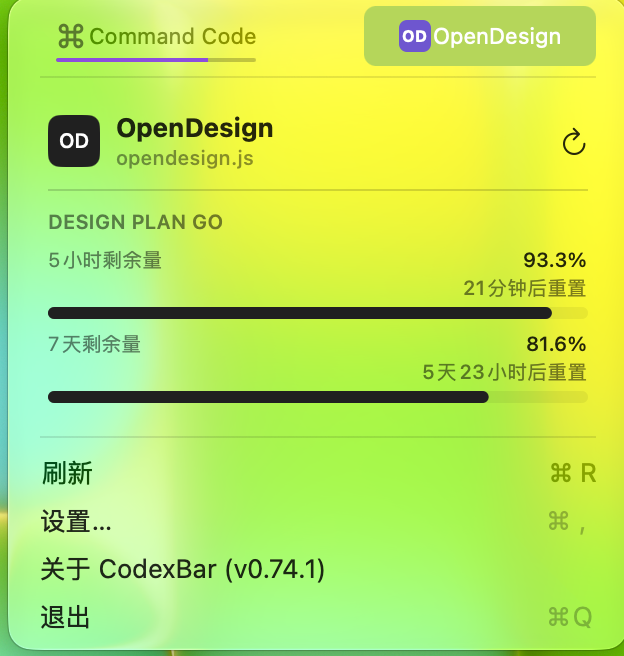

# codexbar-opendesign

[CodexBar](https://github.com/steipete/CodexBar) 的 OpenDesign provider 插件：在菜单栏看 [OpenDesign](https://open-design.ai) Design Plan 的额度、钱包余额和订阅状态。装一个 `.js` 文件就能用。

## 功能

- 卡片第一行是计划名称（`DESIGN PLAN GO` 这种）
- 每个额度窗口一行：`5小时剩余量 98.4%` / `7天剩余量 83.2%`，每行下面带进度条
- 每行右下角带重置倒计时（`2小时1分钟后重置` / `6天1小时后重置`），措辞跟 CodexBar 自己的 `Resets in 2h 13m` 一致
- 计划里有几个窗口就显示几行（自定义套餐的第三个池也在）
- 账号没有 Design Plan 时，改成显示钱包余额

## 显示效果



名称下面那行文件名、右上角的刷新按钮都是 CodexBar 给插件卡片画的外壳，插件改不了；插件能决定的是下面这块内容。

图标：CodexBar 给已安装插件的图标**只支持**「1–3 个字符的字母组合 + 底色」（manifest 里 `icon: { monogram, tint }`，不支持图片/SVG），所以官网的 logo 没法直接拿来用。这里用的是官网配色里的深色底 `#202020` + 白色 `OD`，和它 favicon 的深底白字观感一致；想要真图标只能等 CodexBar 把 OpenDesign 收进内置 provider（内置的可以带 SVG）。

## 安装

1. 把 `opendesign.js` 复制到 `~/.config/codexbar/providers/`，或打开 **Settings → Plugins → Install…** 选这个文件。
2. 审批窗口只列**普通设置**，也只会要求这些权限：

   ```
   origin:       https://amr-api.open-design.ai
   auth:         bearer
   capabilities: http-status
   secrets:      CONTROL_KEY
   ```

   这里的 `Workspace ID` 留空即可（留空 = 用账号当前的 workspace），然后点 Install / Approve。
3. 回到 **Settings → Plugins**，找到 OpenDesign 那一节。`CONTROL_KEY` 是安全设置，**不在上一步的窗口里填**，而是在这一节的两行输入里填：

   - `OpenDesign control key` —— 密码框，粘 `vela_ctrl_…`，**必填**；
   - `Workspace ID (optional)` —— 保持空白即可。
4. 点 `Refresh`，数据就出来了（菜单里的刷新按钮一样）。

还没填 key 时 CodexBar 会直接报 `required secret 'CONTROL_KEY' is unavailable`——看到这句就是上面那个密码框还空着。

## control key 从哪来

control key（`vela_ctrl_…`）和 Open Design 桌面端 / `vela` CLI 用的是同一个，桌面端已登录时直接取：

```bash
jq -r '.profiles.prod.controlKey' ~/.amr/config.json   # profile 名不一定是 prod，兜底用 .profiles[].controlKey
```

也可以跑一次 `vela login` 授权取得（会同时给出控制面的 `vela_ctrl_…` 和模型面的 `sk-amr-…`）。注意：`sk-amr-…` 是模型面 key，控制面不接受它，插件需要的是前者。

## 致谢

- [steipete/CodexBar](https://github.com/steipete/CodexBar)（MIT）— 本地 provider 插件的清单字段、宿主 API 与快照结构。
- [dbydd/opencode-opendesign-auth](https://github.com/dbydd/opencode-opendesign-auth)（MIT）— 控制面接口与鉴权，以及窗口命名和 credits 取整的展示口径。
- [ezdemo/opencode-opendesign-auth](https://github.com/ezdemo/opencode-opendesign-auth)（MIT）— 接口与字段的旁证。
- [nexu-io/open-design](https://github.com/nexu-io/open-design)（Apache-2.0）— 官方 daemon、契约与规范里的 preflight JSON 字段定义。

## 许可

MIT，见 [LICENSE](LICENSE)。
